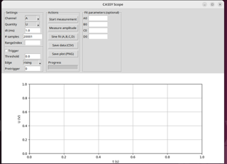
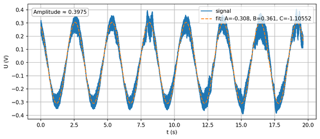

# CASSY Scope

A small Ubuntu/Python oscilloscope GUI for the **Sensor-CASSY 2**.  
It records one trace from channel A or B, displays the signal, estimates its amplitude, fits a sine wave, and saves the data as CSV.

<p align="center">
  
  
</p>

## What the program does

The app connects to the Sensor-CASSY 2 through LD's `.NET` API, loaded from Python with `pythonnet` and Mono. It then:

1. scans for the CASSY device,
2. selects the input channel (`A` or `B`) and quantity (`U` for voltage or `I` for current),
3. sets the oscilloscope time step `dt` and the number of samples,
4. records one trace,
5. plots the measured data,
6. optionally computes the amplitude or fits a sine function,
7. saves the data and plot.

## Data and formulas

For a capture with `N` samples and sampling interval `dt`, the program stores

$$
t_i = i \cdot dt, \qquad y_i = \text{measured voltage or current}
$$

The total acquisition time is approximately

$$
T \approx N \cdot dt
$$

and the sampling frequency is

$$
f_s = \frac{1}{dt}.
$$

### Amplitude estimate

The quick amplitude estimate is computed directly from the measured signal:

$$
A \approx \frac{\max(y) - \min(y)}{2}.
$$

This is useful for a clean periodic signal, but it is only an estimate because noise or spikes can affect the maximum and minimum.

### Sine fit

The fitted model is

$$
f(t) = A \cdot \sin(2\pi \cdot B \cdot t + C) + D
$$

where:

- `A` is the fitted amplitude,
- `B` is the frequency in Hz,
- `C` is the phase in radians,
- `D` is the vertical offset.

The program first guesses the parameters from the data:

$$
\begin{aligned}
A_0 &= \frac{\max(y) - \min(y)}{2},\\
D_0 &= \mathrm{mean}(y),\\
B_0 &= \text{dominant FFT frequency of } y - \mathrm{mean}(y),\\
C_0 &= 0.
\end{aligned}
$$

If SciPy is available, it performs a non-linear least-squares fit using `curve_fit`, i.e. it chooses the parameters that minimize

$$
\sum_i \left[y_i - f(t_i)\right]^2.
$$

If SciPy is not available, the program falls back to a robust approximate method: it scans frequencies around the FFT estimate and solves a linear least-squares problem for

$$
y(t) \approx a \cdot \sin(\omega t) + b \cdot \cos(\omega t) + d,
$$

then converts the result back to amplitude and phase:

$$
A = \sqrt{a^2 + b^2}, \qquad C = \mathrm{atan2}(b, a).
$$

## Installation on Ubuntu

Clone or download this repository, then run:

```bash
sudo ./setup_admin.sh
```

The installer copies the program to `/opt/cassy`, creates a Python virtual environment, installs the required Python packages, installs the udev rule, creates a desktop launcher, and adds the terminal command:

```bash
cassy-scope
```

After installation, unplug and replug the Sensor-CASSY 2. Then start the program either from the application menu as **CASSY Scope** or from a terminal:

```bash
cassy-scope
```

## Saving results

The default output folder is:

```bash
~/CASSY
```

The app can save:

- a CSV file with columns `t,y`,
- a small JSON metadata file with `dt`, sample count, channel, and quantity,
- a PNG image of the current plot.

## Quick test without the GUI

If the GUI does not detect the device, first test the low-level capture script:

```bash
/opt/cassy/.venv/bin/python /opt/cassy/test_scan_capture.py
```

Useful checks are:

```bash
ls -l /dev/ldusb0
ls -l /dev/ttyACM*
ls -l /opt/cassy/lib/*.dll
```

If no device is found, unplug and replug the Sensor-CASSY 2, then try again.

## Uninstall

From the repository folder, run:

```bash
sudo /bin/bash uninstall.sh
```

This removes the installed files in `/opt/cassy`, the desktop launcher, the terminal alias, and the installed icon.
